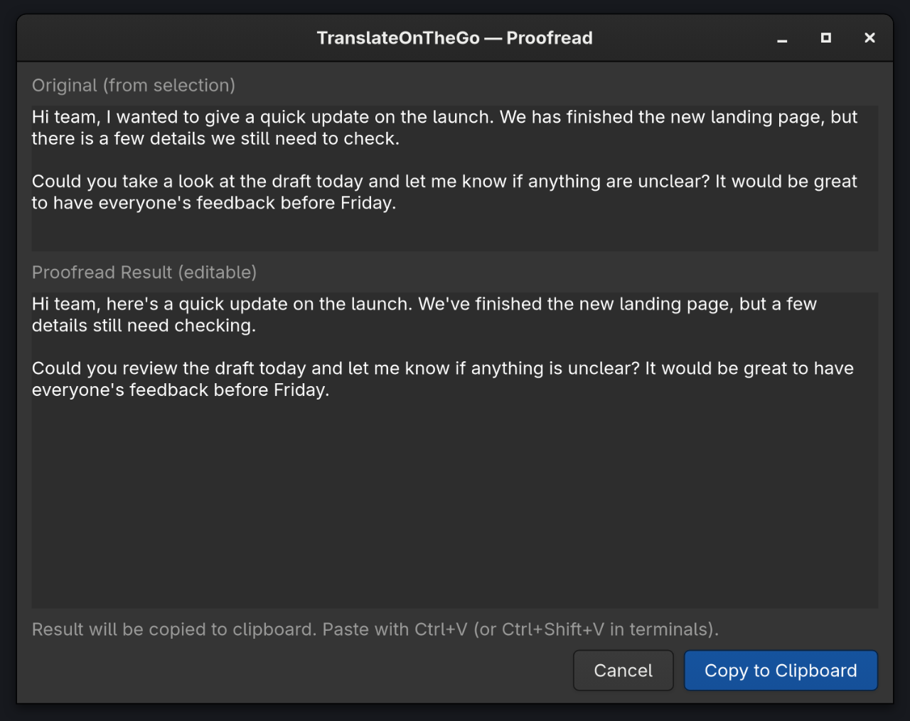

# Omarchy plugin

TranslateOnTheGo adds a **Writing** button to the Omarchy Quattro bar. Select
text, click the button, choose Translate, Proofread, or Correct, then review the
editable result in the GTK4 window and copy it to your clipboard. If the app
doesn't expose its selection, copy the text first; the review window identifies
clipboard input. Vertical bars show **Aa**.



## Which action should I choose?

- **Translate** changes the language. Set `TARGET_LANG` in config (default:
  Korean); text already in that language is translated into English.
- **Proofread** improves grammar, clarity, flow, and naturalness.
- **Correct** asks for spelling, punctuation, and grammar fixes with minimal edits.

[See both screenshots and the everyday workflow](README.md#screenshots).
Screenshots use prepared sample text, not private documents or live requests.

## Requirements

- Omarchy with the Quattro shell and `omarchy plugin` commands.
- `bash`, `coreutils`, `curl`, `jq`, `wl-clipboard`, `libnotify`, `python`,
  `python-gobject`, and `gtk4`.
- One menu picker: Omarchy's `omarchy-menu-select`, Walker, Fuzzel, Wofi, or Rofi.
- A Gemini API key, or an already running Ollama / LM Studio server with a model.

Install missing packages explicitly in a terminal:

```bash
sudo pacman -S --needed curl jq wl-clipboard libnotify python python-gobject gtk4
# Only if none of the supported menu pickers is available:
sudo pacman -S --needed fuzzel
```

## Install and configure

```bash
omarchy plugin add https://github.com/guruthechosen/omarchywritingtool.git --enable
PLUGIN_DIR="$HOME/.config/omarchy/plugins/io.github.guruthechosen.translateonthego"
bash "$PLUGIN_DIR/bin/tot-plugin" --check
bash "$PLUGIN_DIR/bin/tot-plugin" --setup
```

Edit `${XDG_CONFIG_HOME:-$HOME/.config}/translateonthego/config` and configure
your provider using [the setup guide](INSTRUCTION.md#4-pick-a-provider-and-configure-it).
The template uses Gemini and Korean as the target language. Setup creates a
private config file (mode `600`) and preserves any existing config. Existing
standalone users can reuse their provider settings without running setup again.

For local-only use, set `PROVIDER="ollama"` or `PROVIDER="lmstudio"` and
`FALLBACK_ENABLED="false"`. Otherwise, a failed local request can fall back to
Gemini when a key is configured. Local endpoints are configurable; their
defaults use localhost.

The plugin does **not** run `install.sh`. Adding, enabling, or clicking the
widget does not install packages, edit Hyprland config, create command
symlinks, install services, start model servers, or download models. The
optional `tot-llm` systemd integration belongs to the separate standalone
installation. For a plugin-only Ollama setup, install Ollama yourself and
start it explicitly (for example, `ollama serve` in a terminal).

## Use and update

1. Select text, or copy it with `Ctrl+C` if your app does not expose selections.
2. Left-click **Writing** and choose an action. Only then is a request sent.
3. Check the original shown in the review window. Clipboard input is marked
   with a warning; PRIMARY selection takes priority when available.
4. Edit the result if needed, then click **Copy to Clipboard** or press
   `Ctrl+Enter`.
5. Return to your app and paste with `Ctrl+V` (`Ctrl+Shift+V` in terminals).

Press `Esc` to cancel the action menu or review window.

The button launches an independent desktop tool. Disabling the widget or
restarting the shell does not close an already open review window; close that
window normally. There is no background plugin service.

To move the button, update the plugin, or launch directly from a terminal:

```bash
omarchy bar move io.github.guruthechosen.translateonthego --section right
omarchy plugin update io.github.guruthechosen.translateonthego
bash "$HOME/.config/omarchy/plugins/io.github.guruthechosen.translateonthego/bin/tot-plugin"
```

`Super+H` is configured only by the standalone installer, not by plugin
installation. This is a launcher widget, so it does not expose shell
`summon`/`hide` panel routes; the GTK review is an external application.

## Disable or remove

Close any running Writing Tools menu/review before removal or updating.

```bash
omarchy plugin disable io.github.guruthechosen.translateonthego
# Or remove the plugin checkout and its bar placement:
omarchy plugin remove io.github.guruthechosen.translateonthego
```

Provider settings remain in `${XDG_CONFIG_HOME:-$HOME/.config}/translateonthego/`
so API keys and preferences survive reinstalling. Delete this directory manually
only if you no longer need it; standalone installations share it. System packages
and local models are retained. Do not run `uninstall.sh` for a plugin-only
installation; that script removes the standalone integration.

## Permissions and license

The plugin runs as your user. It reads the Wayland selection/clipboard, sends
chosen text to the configured provider, writes private temporary files for
review, and writes the result to the clipboard only when you copy it. Gemini
requests send text to Google over HTTPS; local providers use their configured
HTTP endpoints. There is no telemetry or remote build step. Package installation
is the only step above that needs root. See [SECURITY.md](SECURITY.md) and the
[MIT license](LICENSE).
